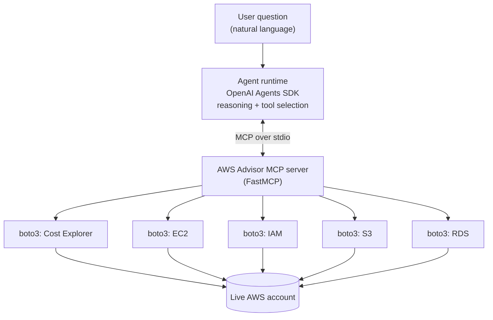

# Agentic AI Cloud Architecture & Cost Advisor

An AI agent that answers plain-English questions about a **live AWS account**, such as "What am I spending money on?" or "Do I have any wasted resources?". Every answer comes from real API calls, not from the model's guesses.

The AWS logic lives in an **MCP (Model Context Protocol) server**, separate from the agent. The same server works with any MCP-capable framework, so the agent runtime can be swapped without touching the AWS code.

   

## Architecture



## Tools exposed by the MCP server

| Tool | What it does | AWS APIs used |
|---|---|---|
| `get_cost_summary(days=7)` | Cost per service over the last N days | Cost Explorer `GetCostAndUsage` |
| `find_idle_resources()` | Finds unattached Elastic IPs and unattached EBS volumes | EC2 `DescribeAddresses`, `DescribeVolumes` |
| `check_well_architected_basics()` | Checks root MFA, S3 Block Public Access, and RDS Multi-AZ | IAM `GetAccountSummary`, S3 `GetPublicAccessBlock`, RDS `DescribeDBInstances` |

The agent decides which tool to call from each tool's docstring and the question. No routing logic is hardcoded.

## Why MCP first?

- **Decoupling:** the tools know about AWS, and the agent knows about reasoning. Either side can change independently.
- **Testability:** the server can be tested on its own with the MCP Inspector, with no LLM involved.
- **Portability:** the same server plugs into the OpenAI Agents SDK, LangGraph (`langchain-mcp-adapters`), CrewAI, or LlamaIndex (`McpToolSpec`).
- **Grounding:** the system prompt forces the agent to report only what the tools return, so it can't invent a cost figure.

## Prerequisites

- Python 3.10+
- Node.js (only for the MCP Inspector)
- AWS credentials configured locally (`aws configure` or SSO). A **read-only** IAM policy is enough, see below.
- An OpenAI API key

## Setup

```bash
git clone https://github.com/ashfaq1192/aws-cloud-advisor-mcp-agent.git
cd aws-cloud-advisor-mcp-agent

python3 -m venv .venv
source .venv/bin/activate        # Windows: .venv\Scripts\activate
pip install -r requirements.txt
```

### 1. Test the MCP server on its own

This needs AWS credentials only, with no OpenAI key:

```bash
npx @modelcontextprotocol/inspector python3 aws_advisor_mcp_server.py
```

A local web UI opens where you can run each tool and inspect the JSON it returns.

### 2. Run the agent

```bash
export OPENAI_API_KEY="<your-key>"     # never commit this
python3 run_advisor_agent.py
```

## Example output

Sample run against my own (nearly empty) learning account:

```text
======================================================================
Q: What has my AWS account spent money on in the last 7 days?
======================================================================
In the last 7 days, your AWS account spent:
- EC2 Compute: $0.0002

======================================================================
Q: Do I have any wasted resources I'm paying for right now?
======================================================================
No. I found no unattached Elastic IPs or EBS volumes currently incurring waste.

======================================================================
Q: Run a basic Well-Architected check and tell me what to fix first.
======================================================================
The basic Well-Architected check found no issues. No fixes are currently indicated.
```

## Least-privilege IAM policy

The server only reads data. This policy covers everything it calls:

```json
{
  "Version": "2012-10-17",
  "Statement": [
    {
      "Effect": "Allow",
      "Action": [
        "ce:GetCostAndUsage",
        "ec2:DescribeAddresses",
        "ec2:DescribeVolumes",
        "iam:GetAccountSummary",
        "s3:ListAllMyBuckets",
        "s3:GetBucketPublicAccessBlock",
        "rds:DescribeDBInstances"
      ],
      "Resource": "*"
    }
  ]
}
```

## Security and cost notes

- **Secrets:** API keys come from environment variables only, and `.gitignore` excludes `.env` files. If a key is ever committed, revoke it immediately.
- **Read-only by design:** no tool creates, modifies or deletes AWS resources.
- **Data sharing:** tool results (account costs, bucket names, resource IDs) are sent to the LLM provider as part of the conversation. Use a sandbox or learning account, not a sensitive production one.
- **Cost Explorer:** each API request is billed at about $0.01. Each question that calls `get_cost_summary` costs roughly that, plus the OpenAI usage.
- **Region:** resources are read from `us-east-1` by default. Set `AWS_REGION` to check another region (Cost Explorer always uses `us-east-1`).

## Repository layout

```
.
├── aws_advisor_mcp_server.py   # MCP server: the three AWS tools
├── run_advisor_agent.py        # Agent runner (OpenAI Agents SDK)
├── requirements.txt
├── .gitignore
└── README.md
```

## Roadmap

- [ ] `check_savings_opportunities` tool (Savings Plans and rightsizing recommendations)
- [ ] More Well-Architected checks (open security groups, unencrypted EBS, CloudTrail enabled)
- [ ] Same server driven by LangGraph, to show framework portability
- [ ] Multi-region scanning
- [ ] Unit tests with `moto` and GitHub Actions CI

## Author

**Muhammad Ashfaq**. Cloud Engineer (AWS Certified AI Practitioner, AWS Certified Cloud Practitioner)uilding agentic AI and cloud automation projects.

## License

MIT
